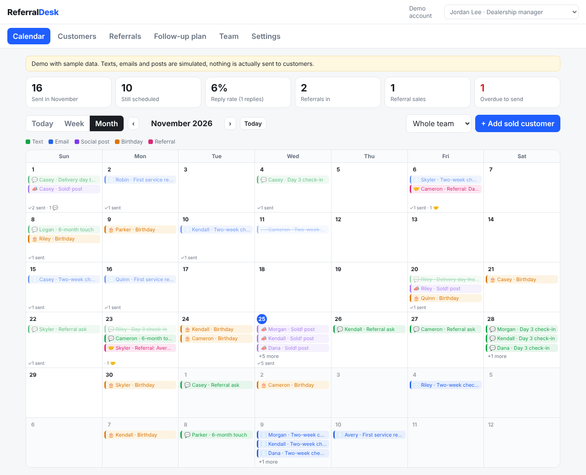

# Referral Desk (demo)

A clickable demo of a follow-up and referral app for car salespeople. You log every sold customer, and the app plans friendly follow-ups by text, email and social post. Each customer gets a personal referral link, so referrals come in without an awkward ask.

The calendar is the main screen. It shows every planned text, email and post, plus birthdays and new referrals, with the month's results across the top.

| Desktop (dealership manager) | Phone (Today view) |
|---|---|
|  |  |

## What's in the demo

- **Calendar:** Today, Week and Month views. Tap anything to edit the message, move the date, skip it or send it.
- **Tap to send:** opens your phone's Messages app (iMessage on iPhone) or email app with the customer and the message filled in.
- **Fully automatic mode:** simulates sending from a registered business number (Twilio in the real app).
- **Add sold customer:** schedules the whole follow-up plan, and records the customer's consent for texts, emails and a photo post.
- **Opt-outs:** unticking consent, or a simulated "STOP" reply, cancels all future messages on that channel.
- **Referral links:** each customer gets a public page at `/r/<code>`. A friend fills it out, and the lead lands under Referrals, credited to that customer.
- **Sold! posts:** solo salespeople share to their personal Facebook from their phone. Dealership posts are marked as going to the dealership's Facebook Page.
- **Follow-up plan:** edit the message templates and the days they go out. On the dealership plan, the manager controls the team's shared plan.
- **Team:** the dealership manager sees a leaderboard and can filter the calendar by salesperson.

## Accounts and sign-in

People sign in, and sign up, with **Continue with Google**. The first time someone signs in, they pick a plan:

- **Just me:** a solo salesperson account.
- **My dealership:** creates a dealership with the person as its manager. Settings shows an 8-letter **invite code** for the team.
- **Join my team:** a salesperson enters the manager's invite code and joins that dealership.

Sessions last 30 days in an HttpOnly cookie. Sign-in uses Google's OpenID Connect with PKCE and a state check, and only Google-verified emails are accepted.

**Demo mode** (`DEMO_MODE=1`, the default) adds a **Try the demo with sample data** button on the sign-in page. It opens the sample accounts with a switcher for a solo salesperson, a dealership manager and two salespeople. Sample accounts can never see or reach real accounts. Set `DEMO_MODE=0` to remove the button and turn off the sample accounts. Nothing in the demo is actually sent to anyone.

### Setting up Google sign-in

1. Go to [Google Cloud Console](https://console.cloud.google.com/) and create a project (or pick one).
2. Under **APIs & Services → OAuth consent screen**, choose **External**, fill in the app name, support email and logo, and add the scopes `openid`, `email` and `profile`. These are basic scopes, so Google doesn't need to review the app. Publish the app ("In production") so anyone with a Google account can sign in.
3. Under **APIs & Services → Credentials**, choose **Create credentials → OAuth client ID → Web application**, and add these **Authorized redirect URIs**:
   - `https://<your-app>.fly.dev/auth/google/callback` (and your custom domain's, if you add one)
   - `http://localhost:8080/auth/google/callback` for local testing
4. Copy the **Client ID** and **Client secret** and give them to the server:

```sh
fly secrets set GOOGLE_CLIENT_ID=... GOOGLE_CLIENT_SECRET=...
```

Locally: `GOOGLE_CLIENT_ID=... GOOGLE_CLIENT_SECRET=... go run .`

Without these two settings, the server still runs, but the Google button is replaced with a note and only the demo works.

## Run it locally

Requires Go 1.26 or newer.

```sh
go run .
# open http://localhost:8080
```

A `ref.db` SQLite file is created and filled with sample data on first run. Delete it to start fresh.

| Setting | Default | Meaning |
|---|---|---|
| `PORT` | `8080` | Port to listen on |
| `DB_PATH` | `ref.db` | SQLite file location |
| `BASE_URL` | `http://localhost:8080` | Public address, used in referral links and the Google redirect URL. Cookies are HTTPS-only when it starts with `https://` |
| `GOOGLE_CLIENT_ID` | (none) | Google OAuth client ID |
| `GOOGLE_CLIENT_SECRET` | (none) | Google OAuth client secret (keep it in `fly secrets`, never in `fly.toml`) |
| `DEMO_MODE` | `1` | `1` shows the sample-data demo, `0` hides it |

## Deploy to fly.io

```sh
fly launch --no-deploy --copy-config   # pick your own app name, then update app + BASE_URL in fly.toml
fly volumes create ref_data --size 1   # same region as primary_region
fly secrets set GOOGLE_CLIENT_ID=... GOOGLE_CLIENT_SECRET=...
fly deploy
```

The database lives on the `ref_data` volume at `/data/ref.db`, so it survives deploys.

## How it's built

- `main.go`: starts the server and serves the `static/` front end (embedded in the binary)
- `api.go`: JSON API, the referral landing page, and the simulated auto-sender
- `auth.go`: Google sign-in, sessions, and first-time account setup (`auth_test.go` runs the whole flow against a fake Google)
- `db.go`: SQLite schema, the default follow-up plan, and the demo data
- `static/`: plain HTML, CSS and JavaScript, with no build step

SQLite comes from `modernc.org/sqlite` (pure Go), so the binary builds with `CGO_ENABLED=0`.

## Not in the demo yet

- Stripe subscriptions
- Real texting (Twilio with 10DLC registration) and email (SendGrid or Postmark)
- Meta app review for automatic Facebook Page and Instagram posting
- Spreadsheet import from dealership CRMs
